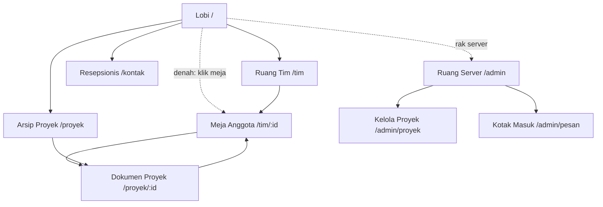
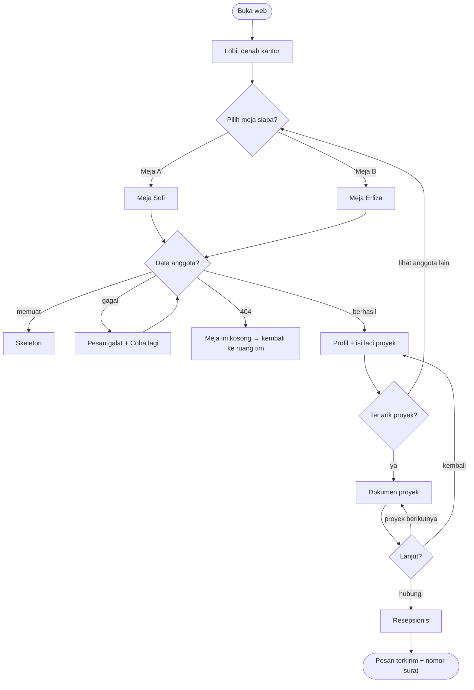
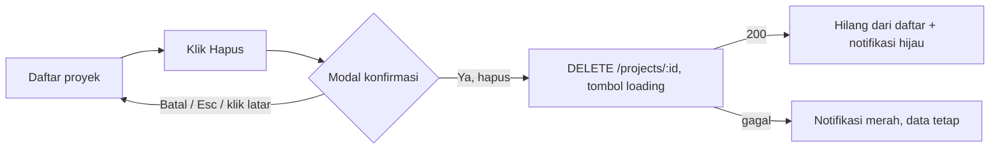

# 04 · User flow

Diagram ditulis dengan Mermaid sehingga langsung tampil di GitHub. Untuk pitch deck, render di <https://mermaid.live> lalu ekspor sebagai PNG/SVG.

## Peta situs

## Alur utama: "kenalan dulu dengan Sofi atau Erliza"

Tujuan pengguna: rekruter ingin tahu kemampuan satu anggota beserta bukti karyanya.

## Alur kontak (interaction flow)

| Aksi pengguna | Respons sistem | State yang berubah |
|---|---|---|
| Membuka `/kontak` | Form kosong dengan petunjuk jumlah karakter | `form` (reactive) kosong |
| Klik **Kirim pesan** dengan isian salah | Kolom bermasalah diberi garis merah + pesan spesifik; fokus pindah ke kolom pertama yang salah; isian benar tetap ada | `submitted = true`, `errors` terisi |
| Memperbaiki kolom | Galat kolom itu hilang saat mengetik (validasi langsung setelah percobaan pertama) | `errors[field]` dihapus |
| Klik **Kirim pesan** dengan isian benar | Tombol berubah "Mengirim pesan…" + spinner, tidak bisa diklik ulang | `sending = true` |
| Server gagal | Kotak galat merah muncul; isian tetap; tombol aktif lagi | `serverError`, `sending = false` |
| Server sukses | Modal "Pesan terkirim" berisi nomor surat; form dikosongkan | `sentMessage`, `form` direset |
| Klik **Batal** saat form terisi | Modal "Buang pesan yang sudah ditulis?" | `confirmDiscard = true` |
| Klik **Batal** saat form kosong | Langsung kembali ke lobi | — |

## Alur admin: hapus proyek

