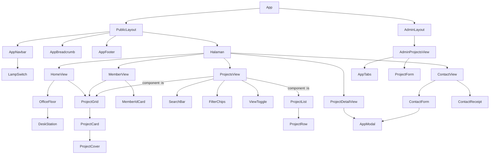

# 05 · Arsitektur komponen

## Pohon komponen

## Komponen reusable utama

| Komponen | Props | Emits / Slots | Dipakai di |
|---|---|---|---|
| `AppButton` | `variant` (primary/secondary/ghost/danger), `size`, `to`, `href`, `loading`, `disabled`, `block` | emit `click`; slot default | Semua halaman. Menjadi `<RouterLink>`, `<a>`, atau `<button>` lewat dynamic component |
| `AppCard` | `as`, `tone` (paper/note/plain), `padded` | slot `header`, default, `footer` | Sticky note lobi, lembar disposisi, statistik admin |
| `AppModal` | `open`, `title`, `confirmText`, `cancelText`, `tone`, `loading` | emit `confirm`, `close`; slot default, **named slot `footer`** | Galeri, konfirmasi batal form, sukses kirim pesan, hapus proyek, hapus pesan |
| `AppTabs` | `tabs`, `modelValue`, `label` | `update:modelValue` (v-model) | Kelola proyek |
| `StateError` | `title`, `message`, `retrying` | emit `retry` | Semua halaman yang memuat API |
| `StateEmpty` | `title`, `message` | slot `actions` | Arsip, meja, detail, kotak masuk, 404 |
| `DeskStation` | `member`, `projectCount`, `active` | emit `select(id)` | `OfficeFloor` (dipakai ulang untuk tiap anggota) |
| `ProjectCard` | `project`, `member` | emit `open(id)` | Lobi, meja anggota, arsip |
| `SearchBar` | `modelValue`, `placeholder`, `label` | `update:modelValue` (v-model) | Arsip |
| `FilterChips` | `modelValue`, `options`, `label` | `update:modelValue` (v-model) | Arsip: **dipakai dua kali** (pemilik & kategori) |

## Prinsip

- **Alur data satu arah:** halaman (induk) memegang state dan mengirimnya lewat props. Komponen anak tidak mengubah data, hanya memancarkan event.
- **Komponen UI tidak tahu soal API:** `ProjectCard` tidak memanggil router atau fetch. Navigasi dan request dilakukan halaman induk.
- **Scoped CSS + token global:** gaya komponen terisolasi, sementara warna, jarak, dan tipografi diambil dari variabel di `main.css`.

## State management (Modul 4)

| Composable | State | Derived (computed) | Aksi |
|---|---|---|---|
| `useProjects` | `projects`, `loading`, `error`, `loaded` | `featuredProjects`, `categories`, `countByMember` | `fetchProjects`, `createProject` (POST), `deleteProject` (DELETE), `projectsOf` |
| `useMembers` | `members`, `loading`, `error`, `loaded` | `memberMap` | `fetchMembers`, `getMemberById` |
| `useMessages` | `messages`, `loading`, `error` | — | `fetchMessages`, `sendMessage` (POST), `deleteMessage` |
| `useRequest` | `data`, `loading`, `error` (lokal per halaman) | — | `run(...args)` |
| `useTheme` | `theme` | — | `toggleTheme`. `watch` menyimpan ke localStorage dan memasang `data-theme` |

State di `useProjects`, `useMembers`, dan `useMessages` dideklarasikan **di luar fungsi** (pola singleton), sehingga lobi, arsip, dan admin membaca sumber data yang sama. Proyek yang ditambahkan di admin langsung muncul di arsip tanpa memuat ulang.

State lokal per halaman: filter arsip (`query`, `category`, `memberId`, `order`, `view`), tab admin (`currentTab`), modal (`target`, `previewIndex`, `confirmDiscard`), form (`reactive`), menu mobile (`menuOpen`).
